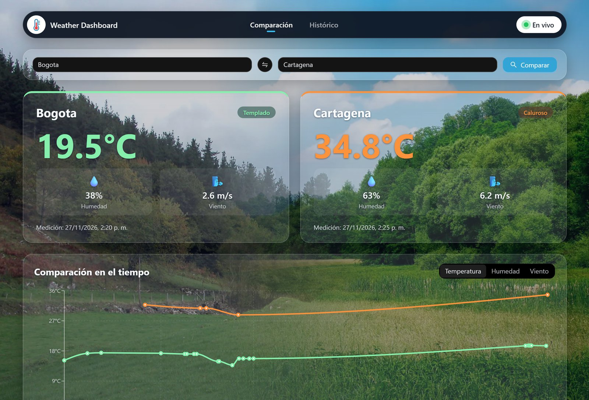
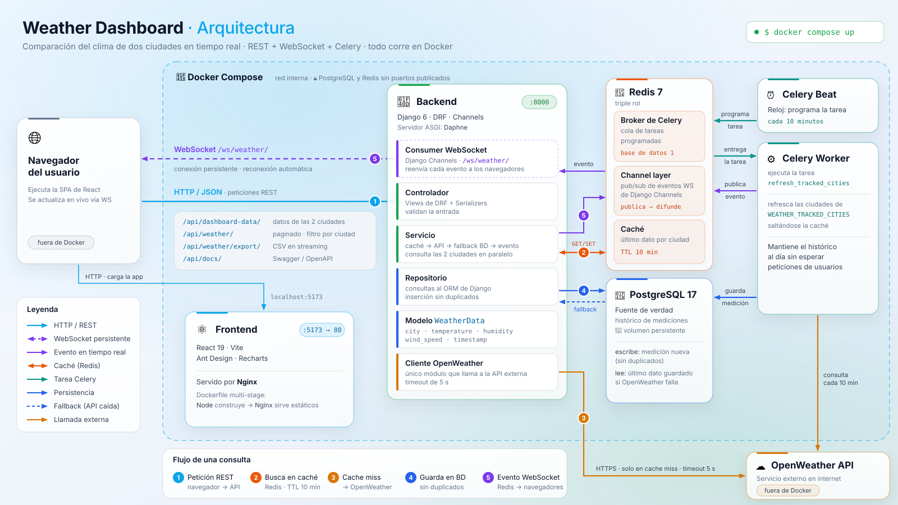

# 🌡️ Weather Dashboard

Dashboard full stack que **compara el clima de dos ciudades en tiempo real**. Consulta [OpenWeather](https://openweathermap.org/), guarda el histórico en PostgreSQL, usa Redis como caché, refresca automáticamente las ciudades configuradas cada 10 minutos con Celery y notifica a todos los navegadores conectados por WebSocket cada vez que llega una medición nueva. Incluye un **asistente con IA** que responde preguntas sobre el histórico usando tools tipadas, sin inventar cifras. Todo se levanta con un solo `docker compose up`.



> **Video de presentación:** [enlace pendiente]

**Stack:** Django 6 · Django REST Framework · Django Channels (Daphne) · Celery · PostgreSQL 17 · Redis 7 · LiteLLM + Gemini · React 19 · Vite · Ant Design · Recharts · Nginx · Docker Compose

---

## Funcionalidades

- **Comparación de dos ciudades** con tarjetas de temperatura, humedad y viento.
- **Ícono del estado real del cielo** (☀️ 🌤️ ☁️ 🌧️ ⛈️ ❄️ 🌫️, 🌙 de noche) y su descripción en español, tal como los reporta OpenWeather.
- **Diseño minimalista:** fondo claro con un difuminado azul sutil; cada ciudad se colorea según su temperatura (frío, templado, cálido, caluroso).
- **Gráfico de series de tiempo** comparando temperatura, humedad o viento de ambas ciudades.
- **Histórico** en tabla con **paginación del servidor** y **filtro por ciudad**.
- **Exportación a CSV** (exporta exactamente lo filtrado).
- **Tiempo real:** la UI se actualiza sola cuando se guarda una medición nueva, con **reconexión automática** del WebSocket y estado de la conexión visible.
- **Refresco automático:** Celery consulta las ciudades configuradas cada 10 minutos, aunque nadie use la app, así el histórico no tiene huecos.
- **Resiliencia:** si OpenWeather falla, responde con el último dato guardado e informa al usuario.
- **Responsive**, estados de carga y mensajes de error en español.
- **API documentada** con Swagger.
- **Asistente del clima (Parte B):** chat que responde preguntas sobre el histórico (*"¿cuál fue la humedad máxima en Medellín?"*) usando tools que consultan la base de datos; muestra la evidencia, se abstiene si no hay datos y conserva el historial de conversaciones.

---

## Cómo levantar el proyecto

**Requisitos:** [Docker Desktop](https://www.docker.com/products/docker-desktop/) (con Docker Compose), una API key gratuita de [OpenWeather](https://home.openweathermap.org/users/sign_up) y, para el asistente, una API key gratuita de [Google AI Studio](https://aistudio.google.com/) (Gemini).

```bash
git clone https://github.com/ramirezluisa503/weather-dashboard.git
cd weather-dashboard
cp .env.example .env          # en Windows (CMD): copy .env.example .env
```

Abre `.env` y escribe tus API keys en `OPENWEATHER_API_KEY` y `LLM_API_KEY`. El resto de valores de ejemplo funciona para un entorno local. Sin `LLM_API_KEY` todo el dashboard funciona igual; solo el asistente responde con un mensaje de error.

```bash
docker compose up --build
```

| Servicio | URL |
|---|---|
|  **Dashboard** | http://localhost:5173 |
|  Documentación de la API (Swagger) | http://localhost:8000/api/docs/ |
|  API REST | http://localhost:8000/api/ |

Las migraciones se aplican solas al arrancar. La base de datos empieza vacía y se llena a medida que se consultan ciudades.

> 💡 Una API key nueva de OpenWeather puede tardar hasta 2 horas en activarse. Mientras tanto, la API responde `401` y el dashboard lo informa.

<details>
<summary><b>Desarrollo local del frontend (con recarga en caliente)</b></summary>

```bash
docker compose stop frontend      # libera el puerto 5173
cd frontend
npm install
npm run dev                       # http://localhost:5173
```
</details>

---

## ⚙️ Variables de entorno

Definidas en `.env` (no se versiona) a partir de [`.env.example`](.env.example) (sin valores reales).

| Variable | Descripción | Valor de ejemplo |
|---|---|---|
| `OPENWEATHER_API_KEY` | API key de OpenWeather (**obligatoria**) | — |
| `POSTGRES_DB` / `POSTGRES_USER` / `POSTGRES_PASSWORD` | Base de datos y credenciales. La imagen de PostgreSQL las crea en el primer arranque | `weather` / `weather_user` / `change_me` |
| `POSTGRES_HOST` / `POSTGRES_PORT` | Host y puerto de PostgreSQL. `db` es el nombre del servicio en Docker | `db` / `5432` |
| `DJANGO_SECRET_KEY` | Clave secreta de Django | `change_me` |
| `DJANGO_DEBUG` | Modo depuración (`True`/`False`). Por defecto `False` si falta | `True` |
| `DJANGO_ALLOWED_HOSTS` | Hosts aceptados por Django, separados por coma | `localhost,127.0.0.1` |
| `CORS_ALLOWED_ORIGINS` | Frontends autorizados a consumir la API desde el navegador | `http://localhost:5173` |
| `REDIS_URL` | Redis para la caché y el channel layer | `redis://redis:6379/0` |
| `WEATHER_CACHE_TTL_SECONDS` | **TTL de la caché** por ciudad, en segundos | `600` (10 min) |
| `CELERY_BROKER_URL` | Broker de Celery (base de datos 1 de Redis, separada de la caché) | `redis://redis:6379/1` |
| `WEATHER_TRACKED_CITIES` | Ciudades que Celery refresca automáticamente, separadas por coma | `Bogota,Medellin,Cali,Cartagena` |
| `WEATHER_REFRESH_SECONDS` | Cada cuántos segundos se ejecuta el refresco | `600` (10 min) |
| `LLM_MODEL` | Modelo del asistente en formato LiteLLM `proveedor/modelo` | `gemini/gemini-3.5-flash-lite` |
| `LLM_API_KEY` | API key del proveedor del modelo (solo la usa el backend) | — |
| `LLM_FALLBACK_MODELS` | Modelos de respaldo si el principal está saturado o sin cupo, separados por coma | `gemini/gemini-3.1-flash-lite` |

El frontend usa además `VITE_API_URL` (argumento de build, por defecto `http://localhost:8000`): es la URL del backend **tal como la ve el navegador**, no el contenedor.

---

## Arquitectura



El navegador descarga la SPA de React desde Nginx y luego habla directamente con el backend Django: peticiones REST para consultar, paginar y exportar datos, y un WebSocket permanente para recibir actualizaciones. Ante cada consulta, la capa de servicio busca primero en Redis (caché de 10 min); solo si no hay dato llama a OpenWeather, guarda la medición en PostgreSQL y, si la API falla, responde con el último dato guardado. Cada medición nueva se publica en el channel layer de Redis y Django Channels la reenvía por WebSocket, así todos los navegadores conectados se actualizan sin recargar. Además, **Celery Beat** programa cada 10 minutos una tarea que el **Celery Worker** ejecuta para refrescar las ciudades configuradas (saltándose la caché); sus mediciones nuevas también se emiten por WebSocket a través del channel layer, aunque el worker sea otro proceso. PostgreSQL y Redis solo son accesibles desde la red interna de Docker.

El **asistente** (app `agent`) recibe la pregunta por REST, conversa con el LLM a través de LiteLLM y ejecuta en el backend las tools que el modelo pide, que leen PostgreSQL con el ORM. Ver [Parte B](#-parte-b-asistente-con-agente-y-tools).

> Redis cumple tres roles: **caché** (base de datos 0), **channel layer** de Django Channels y **broker** de Celery (base de datos 1).

### Backend en capas

Cada capa solo llama a la de abajo: las views nunca hablan directamente con la base de datos ni con OpenWeather.

| Capa | Archivo | Responsabilidad |
|---|---|---|
| Controlador | `views.py` + `serializers.py` | HTTP: valida la entrada y traduce errores a códigos (400 / 404 / 503) |
| Servicio | `services.py` | Lógica: caché → OpenWeather → fallback a la BD → evento WebSocket |
| Cliente externo | `openweather_client.py` | Único módulo que llama a OpenWeather (timeout, errores propios) |
| Repositorio | `repositories.py` | Consultas al ORM reutilizables (deduplicación, último dato, histórico) |
| Modelo | `models.py` | `WeatherData` (ciudad, temperatura, humedad, viento, estado del cielo, timestamp) con índice `(city, -timestamp)` y restricción única `(city, timestamp)` |
| Tiempo real | `consumers.py` + `routing.py` | Consumer WebSocket y rutas de Channels |
| Tareas periódicas | `tasks.py` + `config/celery.py` | Refresco automático de las ciudades configuradas (Celery) |

###  Estructura del proyecto

```
weather-dashboard/
├── docker-compose.yml             # 6 servicios: db, redis, backend, frontend,
│                                  #   celery-worker, celery-beat
├── .env.example                   # variables de entorno (sin valores reales)
├── README.md
│
├── docs/
│   ├── arquitectura.svg           # diagrama de arquitectura
│   └── captura-dashboard.jpg      # captura para el README
│
├── backend/                       # Django + DRF + Channels
│   ├── Dockerfile                 # Python 3.13-slim
│   ├── .dockerignore
│   ├── requirements.txt           # dependencias con versión fija
│   ├── manage.py
│   │
│   ├── config/                    # configuración del proyecto
│   │   ├── settings.py            # lee todo de variables de entorno
│   │   ├── urls.py                # /api/, /api/chat/, /api/docs/, /admin/
│   │   ├── asgi.py                # HTTP → Django · WebSocket → Channels
│   │   ├── celery.py              # configuración de Celery
│   │   └── wsgi.py
│   │
│   ├── weather/                   # app del dominio del clima
│   │   ├── models.py              # modelo WeatherData
│   │   ├── migrations/            # historial de la base de datos
│   │   ├── openweather_client.py  # cliente de la API externa
│   │   ├── repositories.py        # consultas al ORM
│   │   ├── services.py            # lógica: caché → API → fallback
│   │   ├── serializers.py         # validación de entrada y JSON
│   │   ├── views.py               # controladores (endpoints REST)
│   │   ├── pagination.py          # paginación del histórico
│   │   ├── urls.py                # rutas de la API
│   │   ├── consumers.py           # consumer WebSocket
│   │   ├── routing.py             # rutas WebSocket (/ws/weather/)
│   │   ├── tasks.py               # tarea periódica de Celery
│   │   ├── tests.py               # 14 tests del clima
│   │   ├── admin.py
│   │   └── apps.py
│   │
│   └── agent/                     # app del asistente (Parte B)
│       ├── models.py              # Conversation, Message, ToolCall
│       ├── tools.py               # tools tipadas + esquemas para el LLM
│       ├── services.py            # ciclo del agente (LiteLLM)
│       ├── serializers.py
│       ├── views.py               # endpoints del chat (con límite)
│       ├── urls.py
│       ├── tests.py               # 17 tests (LLM simulado)
│       ├── evals/eval_set.json    # 8 preguntas de evaluación
│       └── management/commands/
│           └── run_evals.py       # eval contra el LLM real
│
└── frontend/                      # React + Vite + Ant Design
    ├── Dockerfile                 # multi-stage: Node construye, Nginx sirve
    ├── nginx.conf                 # servidor de los archivos estáticos
    ├── .dockerignore
    ├── package.json               # dependencias y scripts
    ├── package-lock.json
    ├── vite.config.js
    ├── eslint.config.js
    ├── index.html
    │
    ├── public/                    # se sirve tal cual
    │   └── icons/termometro.svg   # ícono de la pestaña
    │
    └── src/
        ├── main.jsx               # punto de entrada + tema de Ant Design
        ├── App.jsx                # vistas, estado y tiempo real
        ├── index.css              # estilos globales (responsive)
        │
        ├── api/                   # únicos módulos que hablan con el backend
        │   ├── client.js          # cliente HTTP común (URL, errores)
        │   ├── weatherApi.js      # endpoints del clima
        │   └── chatApi.js         # endpoints del chat
        │
        ├── hooks/
        │   ├── useDashboard.js        # datos de las dos ciudades
        │   ├── useWeatherHistory.js   # histórico paginado
        │   ├── useWeatherSocket.js    # WebSocket con reconexión
        │   └── useChat.js             # conversaciones y estado del agente
        │
        ├── components/
        │   ├── Navbar.jsx             # navegación y estado en vivo
        │   ├── CitySelector.jsx       # selección de ciudades
        │   ├── WeatherCard.jsx        # tarjeta del clima actual
        │   ├── ComparisonChart.jsx    # gráfico de comparación
        │   ├── HistoryTable.jsx       # tabla, filtro y exportar CSV
        │   └── AssistantPanel.jsx     # chat con el asistente
        │
        └── utils/
            ├── weatherTheme.js    # color según la temperatura
            └── weatherIcon.js     # ícono según el estado del cielo
```

---

##  API

| Método | Endpoint | Descripción |
|---|---|---|
| `GET` | `/api/dashboard-data/?city1=&city2=` | Endpoint optimizado del dashboard: clima actual de las dos ciudades + últimos 24 registros de cada una, en **una sola petición** |
| `GET` | `/api/weather/?city=&page=&page_size=` | Histórico **paginado** (10 por defecto, máximo 100) con filtro opcional por ciudad |
| `GET` | `/api/weather/export/?city=` | Exportación del histórico a **CSV** (streaming) |
| `WS` | `/ws/weather/` | Eventos `weather_created` cada vez que se guarda una medición nueva |
| `GET` / `POST` | `/api/chat/conversations/` | Lista las conversaciones (más reciente primero) / crea una |
| `GET` | `/api/chat/conversations/<id>/` | Conversación con sus mensajes y las tools usadas |
| `POST` | `/api/chat/conversations/<id>/messages/` | Envía una pregunta al agente y devuelve la respuesta con su evidencia (máximo 10 por minuto) |

La ruta de la prueba `GET /weather/` se expone como `/api/weather/` (prefijo `/api/` para separar la API de otras rutas). Documentación interactiva en **`/api/docs/`**.

Cada respuesta del clima actual incluye `"source": "cache" | "api" | "database"`, para indicar de dónde salió el dato.

---

##  Decisiones técnicas y trade-offs

| Decisión | Por qué | Alternativa descartada |
|---|---|---|
| **Arquitectura en capas** (controlador → servicio → repositorio → modelo) | La lógica de caché, API externa y fallback vive en un solo lugar y es fácil de probar; cambiar de proveedor del clima solo toca el cliente | MVT "puro" con lógica en las views; Clean/Hexagonal (excesiva para el alcance) |
| **Caché Redis por ciudad con TTL de 600 s** | El clima no cambia en segundos y OpenWeather actualiza cada ~10 min: se responde en milisegundos y se protege la cuota del plan gratuito. Redis es una copia temporal; **PostgreSQL es la fuente de verdad** | Sin caché (lento y gasta la cuota); TTL largo (datos desactualizados) |
| **Fallback a la BD** si OpenWeather falla | El usuario recibe el último dato guardado, marcado como `source: "database"` y avisado en la UI. Si no hay datos, `503` claro en vez de inventar | Responder error siempre |
| **Deduplicación en dos capas** | `get_or_create` evita duplicados en el código y la restricción única de la BD los impide incluso con peticiones simultáneas | Solo validar en el código |
| **Paginación en el servidor** + QuerySets perezosos | PostgreSQL devuelve solo las filas de la página (`LIMIT/OFFSET`): el tiempo no depende del tamaño del histórico. `max_page_size=100` protege la BD | Paginar en el frontend (descargaría todo) |
| **`/dashboard-data/` optimizado** | Una petición en vez de cuatro, clima actual desde caché, histórico limitado y con `.values()` | Varias peticiones desde el frontend |
| **Consultas a OpenWeather en paralelo** (`ThreadPoolExecutor`) | Es espera de red (I/O): el tiempo sin caché bajó de ~0,8 s a ~0,36 s (−55 %). Se cierra la conexión a la BD de cada hilo | Consultas secuenciales |
| **CSV en streaming** (`StreamingHttpResponse` + generadores) | La memoria no crece con el tamaño del histórico. Incluye BOM para que Excel muestre bien las tildes | Generar el archivo completo en memoria |
| **WebSocket con Django Channels**, Redis como channel layer | El servidor avisa cuando hay datos nuevos, sin polling. Redis ya estaba en el stack | Polling desde el frontend |
| **El evento solo se emite si el registro es nuevo** y su fallo no rompe la petición | Respeta "emitir eventos al insertar datos"; el tiempo real es un complemento, el dato ya quedó guardado | Emitir en cada consulta |
| **Refresco periódico con Celery** (worker + beat, broker en Redis) | El backend trae datos cada 10 min aunque nadie consulte, así el histórico no tiene huecos; combinado con el WebSocket, las pantallas se actualizan solas. La tarea se salta la caché (si no, no traería nada nuevo) y si una ciudad falla las demás siguen. Broker en una base de datos de Redis distinta de la caché | Polling desde cada navegador (más peticiones y no llena el histórico) |
| **Reconexión con backoff exponencial** (1 s → 30 s) | Se recupera sola tras caídas sin saturar al servidor | Reintentos constantes |
| **Frontend con Nginx (Dockerfile multi-stage)** | La imagen final solo tiene Nginx y los estáticos: más liviana y segura | Servidor de desarrollo de Vite dentro del contenedor |
| **Diseño minimalista** (fondo claro, tarjetas blancas, color por temperatura) | En un dashboard los protagonistas son los datos; las fotos de fondo saturaban la vista y obligaban a sombrear el texto. El color por temperatura se conserva porque aporta información | Fotos de fondo por temperatura (versión anterior) |
| **Ícono según el estado real del cielo** | OpenWeather ya envía el estado del cielo en la misma respuesta (`weather[0]`): se guarda (`condition`, `description` en español con `lang=es`, `icon` con día/noche) y se traduce a un emoji. No requiere llamadas extra y no inventa datos | Deducir sol o nube a partir de la temperatura (podría ser falso) |
| **Navbar con tres vistas** (Comparación / Histórico / Asistente) | Reduce el scroll; las vistas se ocultan sin desmontarse para conservar el filtro, la página de la tabla y la conversación abierta | Una sola página larga |

---

## Resiliencia y seguridad

- **OpenWeather:** timeout de 5 s y excepciones propias (`CityNotFoundError` → 404, `OpenWeatherError` → fallback a la BD → 503 si no hay datos).
- **Logs claros** con fecha, nivel y módulo (`Cache HIT/MISS`, `Fallback a la BD`, `Nuevo registro`…). Los errores de conexión no imprimen la URL para **no filtrar la API key**.
- **Validación de entrada** con serializers: lista blanca de caracteres para la ciudad (letras con tildes, espacios, `-`, `.`, `'`) y longitud máxima → `400` con mensaje en español.
- **SQL injection:** el ORM de Django usa consultas parametrizadas. **XSS:** la API responde JSON, la validación rechaza `<` y `>`, y React escapa el contenido.
- **CORS** con lista blanca de orígenes (no se permite cualquier origen). **WebSockets** protegidos con `AllowedHostsOriginValidator`, ya que no tienen protección CSRF. El clima solo expone `GET`; el chat usa `POST`, y **CSRF no aplica** porque la API no usa sesiones ni cookies (se deja explícito con `authentication_classes = []`).
- **Secretos** solo en `.env` (ignorado por Git); `.env.example` sin valores reales. La API key del LLM solo la usa el backend: nunca llega al navegador ni se registra en los logs. PostgreSQL y Redis no publican puertos fuera de Docker.
- **Asistente:** tools con parámetros cerrados y validados (sin SQL, shell ni URLs), límite de 10 preguntas por minuto por IP, preguntas de máximo 1000 caracteres, máximo 4 vueltas LLM ⇄ tools y timeout de 30 s. El texto del LLM se muestra como texto de React (las negritas se convierten en elementos, nunca en HTML), así que no puede inyectar scripts.

---

##  Tests

El backend tiene **31 tests** (14 del clima + 17 del asistente). Con los contenedores encendidos:

```bash
docker compose exec backend python manage.py test -v 2
```

**Clima (`weather/tests.py`):**

| Qué se prueba | Tests |
|---|---|
| Caché: la segunda consulta no llama a OpenWeather | `test_segunda_consulta_sale_de_la_cache` |
| Se guarda el estado del cielo (condición, descripción e ícono) | `test_guarda_el_estado_del_cielo` |
| Fallback a la BD si OpenWeather falla · error si no hay datos | `test_fallback_a_la_bd_si_openweather_falla`, `test_sin_datos_y_api_caida_lanza_error` |
| Deduplicación de mediciones | `test_misma_medicion_no_se_duplica` |
| `/dashboard-data/`: orden, 404, 503 y 400 | `test_devuelve_las_dos_ciudades_en_orden`, `test_ciudad_inexistente_responde_404`, `test_api_caida_sin_datos_responde_503`, `test_misma_ciudad_responde_400` |
| `/weather/`: paginación, filtro y validación | `test_paginacion_del_backend`, `test_filtro_por_ciudad_normalizada`, `test_ciudad_con_caracteres_invalidos_responde_400` |
| Exportación CSV filtrada | `test_exporta_csv_filtrado` |
| Tarea de Celery: se salta la caché y tolera el fallo de una ciudad | `test_refresca_las_ciudades_y_tolera_fallos` |

- OpenWeather se **simula** con `unittest.mock`: los tests no dependen de internet ni de la cuota de la API.
- Caché y channel layer **en memoria** durante los tests; Django usa una base de datos de prueba que crea y borra sola.
- El dashboard se prueba con `TransactionTestCase`, porque consulta las ciudades en hilos con su propia conexión a la BD.

**Asistente (`agent/tests.py`)**, con el LLM **simulado** (no gastan cupo y siempre dan el mismo resultado):

| Qué se prueba | Tests |
|---|---|
| Las tools calculan en la BD: promedio, mínimo y máximo exactos, rango de fechas, ciudad normalizada, límite de filas | `test_promedio_calculado_en_la_bd`, `test_filtra_por_rango_de_fechas`, `test_normaliza_la_ciudad`, `test_consultar_clima_respeta_el_limite` |
| Ciudad sin datos → 0 registros (base de la abstención) | `test_ciudad_sin_datos_devuelve_cero_registros` |
| Argumentos inválidos (métrica, operación, fechas al revés, caracteres de inyección) y tool inexistente | `test_rechaza_argumentos_invalidos`, `test_tool_inexistente` |
| Ciclo del agente: ejecuta la tool, el número lo calcula el backend y se guarda la evidencia | `test_ejecuta_la_tool_y_guarda_la_evidencia` |
| Contexto de la conversación, argumentos inválidos sin romper, límite de pasos | `test_envia_el_historial_como_contexto`, `test_argumentos_invalidos_no_rompen_el_agente`, `test_limite_de_pasos` |
| LLM caído → mensaje claro · modelo de respaldo ante un 503 | `test_llm_no_disponible`, `test_usa_el_modelo_de_respaldo` |
| Endpoints: 201 con historial persistente, 400, 404 y 429 al pasar el límite | `test_pregunta_y_detalle`, `test_pregunta_vacia`, `test_conversacion_inexistente`, `test_limite_de_peticiones` |

**Eval set del agente** (LLM real): ver [Evaluación](#evaluación).

---

##  Limitaciones y mejoras futuras

- **El refresco automático solo cubre las ciudades configuradas** en `WEATHER_TRACKED_CITIES`; las demás se actualizan cuando alguien las consulta. Mejora: refrescar también las ciudades consultadas en las últimas horas.
- **Sin tests del frontend:** se verificó manualmente y con capturas en distintos tamaños de pantalla.
- **El bundle de JavaScript supera los 500 KB** (Ant Design + Recharts). Mejora: división de código con `import()` dinámico.
- Los registros guardados antes de agregar el estado del cielo no tienen ícono (los campos quedan vacíos); se completan solos con las mediciones nuevas.
- **El backend usa el servidor de desarrollo ASGI** (`runserver` con Daphne) con `DEBUG=True`, pensado para la ejecución local de la prueba. En producción: Daphne/Uvicorn directo, `DEBUG=False` y archivos estáticos servidos aparte.
- Frontend en **JavaScript** por tiempo; con más tiempo usaría TypeScript.
- **Asistente:** el filtro compara el nombre de la ciudad tal como se guardó: *"Tokio"* no encuentra los datos guardados como *"Tokyo"*. Se mitiga enviando al modelo la lista de ciudades guardadas; mejora: alias o búsqueda sin tildes. Depende del cupo gratuito de Gemini (mitigado con modelo de respaldo y límite de peticiones), responde sin streaming y no hay usuarios: todas las conversaciones son compartidas.
- Mejoras posibles: integración continua (GitHub Actions) para correr los tests en cada push.

---

## 🤖 Parte B: asistente con agente y tools

La pestaña **Asistente** (también accesible con el botón flotante 🤖 de las otras vistas) es un chat que responde preguntas sobre el **histórico guardado en PostgreSQL**, por ejemplo:

- *¿Cuál es la temperatura promedio de Bogotá?*
- *¿Cuál fue la humedad máxima en Medellín entre el 26 y el 28 de noviembre?*
- *Muéstrame las últimas 5 mediciones de Cali*

Cada respuesta muestra, en un desplegable, **qué tools usó el agente, con qué argumentos y qué devolvieron**.

### Cómo funciona

```
Pregunta → [instrucciones + historial + pregunta + esquemas de las tools] → LLM
              ↑                                                            │
              └── resultado de la tool ←── backend valida y ejecuta ←── pide una tool
                                                                           │
                                                          respuesta final ←┘ (máx. 4 vueltas)
```

1. El backend guarda la pregunta y envía al LLM las **instrucciones del sistema**, los últimos 10 mensajes (para entender *"¿y la máxima?"*) y los **esquemas de las tools**.
2. Si el modelo pide una tool, el **backend valida los argumentos y la ejecuta**; el resultado vuelve al modelo.
3. Cuando el modelo responde con texto, se guardan la respuesta y las tool calls (con un resultado **saneado**: máximo 5 filas) y se devuelven al frontend.

### Tools

| Tool | Argumentos | Devuelve |
|---|---|---|
| `consultar_clima` | `ciudad`, `desde`, `hasta` (opcionales), `limite` (1 a 50) | Mediciones (más recientes primero) con su `id`, el total que cumple el filtro y los filtros aplicados |
| `calcular_estadistica` | `metrica` (temperatura, humedad, viento), `operacion` (promedio, mínimo, máximo), `ciudad`, `desde`, `hasta` | El valor **calculado por PostgreSQL** (`AVG`/`MIN`/`MAX`), su unidad, los filtros y cuántos registros se usaron |

- **Tipadas y cerradas:** el LLM solo propone argumentos; el backend los valida con serializers de DRF (valores permitidos, fechas, lista blanca de caracteres) y consulta con el ORM. **No hay SQL arbitrario, shell ni URLs**. Un argumento inválido vuelve al modelo como error, sin romper nada.
- **La aritmética nunca la hace el LLM:** promedios, mínimos y máximos los calcula la base de datos.

### Reglas del agente

Definidas en las instrucciones del sistema ([`agent/services.py`](backend/agent/services.py)):

| Regla | Comportamiento |
|---|---|
| **Grounding** | Usa siempre las tools; nunca cifras de su conocimiento general |
| **Evidencia** | Cita ciudad, rango de fechas y número de registros usados |
| **Abstención** | Si una tool devuelve 0 registros, dice que no hay datos guardados |
| **Aclaración** | Si falta la ciudad, la pregunta antes de consultar |
| **Fuera de tema** | Explica que solo responde sobre el histórico del clima |
| **Fechas** | Interpreta las fechas en UTC (recibe la fecha de hoy) |

El prompt también incluye la **lista de ciudades con datos**, tomada de la base de datos.

### Modelo y cómo cambiarlo

Se usa **Gemini** (`gemini-3.5-flash-lite`, plan gratuito de Google AI Studio) a través de **[LiteLLM](https://docs.litellm.ai/)**, que ofrece la misma interfaz para muchos proveedores. **Cambiar de modelo o de proveedor no requiere tocar el código**, solo el `.env`:

```env
LLM_MODEL=gemini/gemini-3.5-flash-lite      # o, por ejemplo, openai/<modelo>, anthropic/<modelo>
LLM_API_KEY=tu_api_key                       # la key de ese proveedor
LLM_FALLBACK_MODELS=gemini/gemini-3.1-flash-lite
```

Si el modelo principal responde que está saturado, sin cupo, con timeout o sin conexión, el agente **prueba automáticamente los modelos de respaldo**. Si todos fallan, el usuario ve *"El asistente no está disponible en este momento…"*, sin detalles internos.

### Persistencia e interfaz

- **Modelos:** `Conversation` → `Message` (pregunta o respuesta, con marca de error) → `ToolCall` (nombre, argumentos, resultado saneado, error y duración en ms). El historial sobrevive a recargar la página.
- **Interfaz:** lista de conversaciones, indicador *"El asistente está consultando los datos…"* (estado del run), actualización optimista (la pregunta aparece al instante y se retira si falla) y la evidencia de las tools en un desplegable.

### Evaluación

Además de los 17 tests con el LLM simulado, un **eval set de 8 preguntas** ([`agent/evals/eval_set.json`](backend/agent/evals/eval_set.json)) mide el comportamiento del **modelo real**:

```bash
docker compose exec backend python manage.py run_evals
```

| Tipo | Casos | Se verifica |
|---|---|---|
| Estadística | 4 (las 3 operaciones y las 3 métricas) | Tool y argumentos correctos, **el mismo valor que calcula la BD** y el número de registros |
| Consulta | 1 | Tool correcta y que incluya la medición más reciente |
| Abstención | 1 (ciudad sin datos) | Dice que no hay datos y **no inventa una temperatura** |
| Aclaración | 1 (sin ciudad) | Pregunta la ciudad sin usar tools |
| Fuera de tema | 1 | No usa tools y explica su alcance |

La respuesta esperada se calcula **en el momento** con las mismas tools, porque los datos crecen cada 10 minutos. **Resultado: 8/8 (100 %)** con `gemini-3.5-flash-lite`. No forma parte de los tests automáticos porque consume cupo del LLM y un modelo no responde siempre igual.

### Decisiones de la Parte B

| Decisión | Por qué | Alternativa descartada |
|---|---|---|
| **LiteLLM** | Una sola interfaz para cualquier proveedor: cambiar de modelo es cambiar una variable, y permite el modelo de respaldo | SDK de un solo proveedor |
| **Tools tipadas** con parámetros cerrados | Seguras (sin inyección) y verificables; la evidencia sale de resultados estructurados | Dejar que el LLM escriba SQL (*text-to-SQL*) |
| **Estadísticas en la BD** | Un LLM puede equivocarse con la aritmética; PostgreSQL no | Enviar las filas al LLM para que calcule |
| **Respuesta síncrona** | Simple: una pregunta tarda pocos segundos y el frontend muestra el estado del run | Streaming o tarea en Celery (más complejidad para este alcance) |
| **Límite de 10 preguntas por minuto** | Cada pregunta consume cupo del LLM; se revisa antes de llamarlo | Sin límite |

---

##  Tiempo invertido

| Día | Horas | Trabajo |
|---|---|---|
| Martes 24 nov | ~2 h | Preparación: entorno, API key, configuración, decisión de arquitectura |
| Miércoles 25 nov | ~2 h | Proyecto Django, modelo, configuración por variables de entorno |
| Jueves 26 nov | ~10 h | Docker, backend completo (caché, servicio, endpoints, CSV, Swagger, WebSockets) y frontend |
| Viernes 27 nov | ~6 h 45 min | Frontend en Docker, consultas en paralelo, tests, Celery, diagrama, README, diseño minimalista e ícono del estado del cielo; inicio de la Parte B (LiteLLM, modelos del chat, tools) |
| Sábado 28 / Domingo 29 nov | [pendiente] | [pendiente] |
| **Total** | **[pendiente]** | |

---

##  Uso de IA

Desarrollé el proyecto con apoyo de **Claude Code** (modelo Claude Opus 5.5, extensión de VS Code) y **Claude**, usándolos como **tutor y asistente paso a paso**: para explicar conceptos, proponer alternativas con sus trade-offs, revisar mi código, diagnosticar errores y verificar el resultado. Tomé las decisiones técnicas y de diseño, escribí gran parte del código y validé cada paso en mi máquina antes de avanzar.

---

## Créditos

- **Ícono de la pestaña:** termómetro dibujado en SVG para este proyecto.
- **Datos del clima:** [OpenWeather](https://openweathermap.org/) (Current Weather API, plan gratuito).
